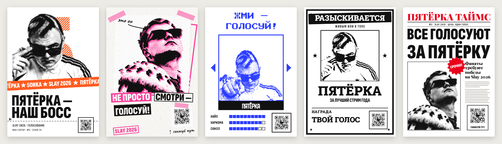
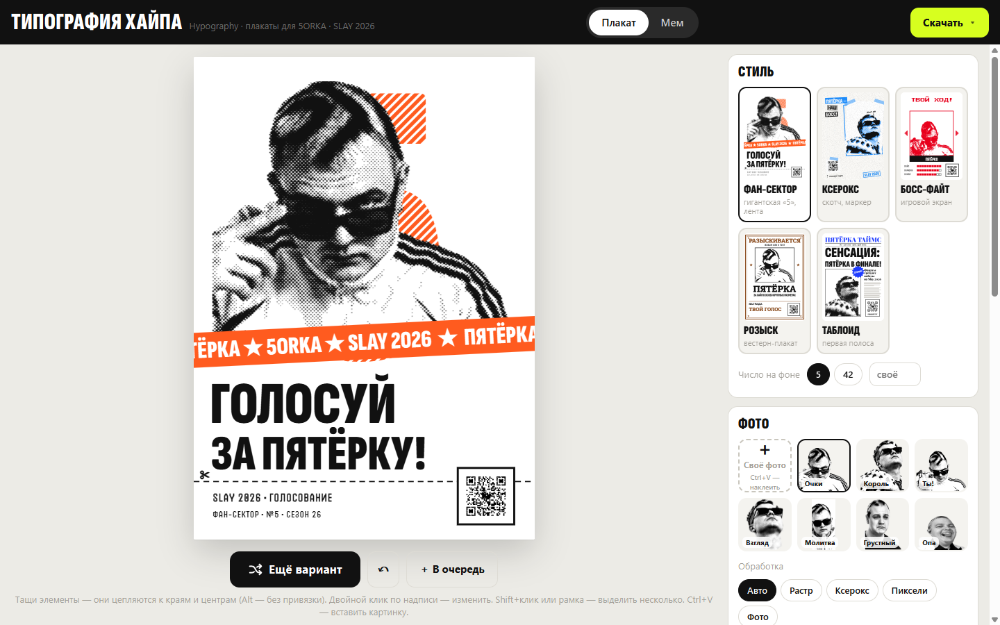
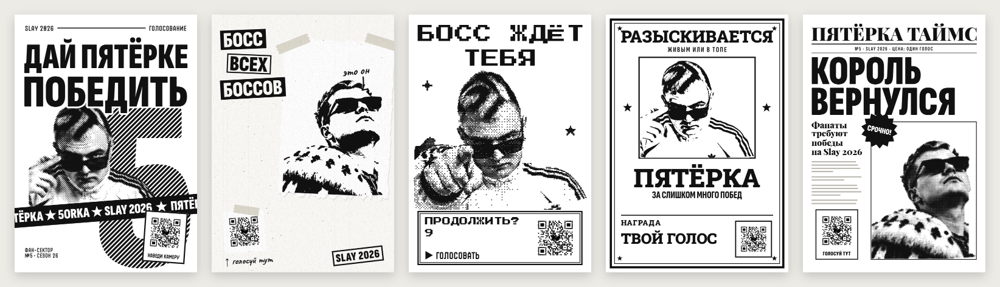
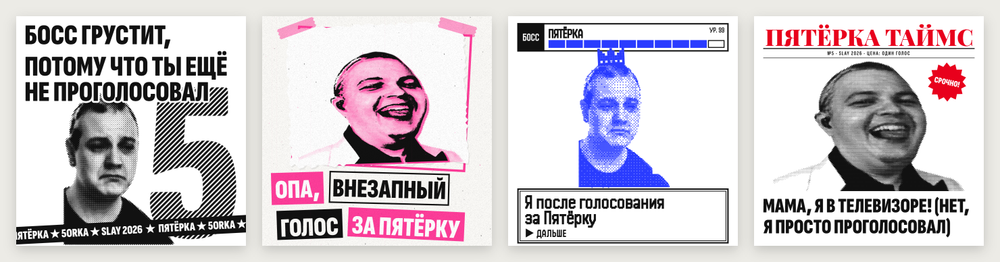

# Типография хайпа · Hypography

**Программа, которая сама верстает плакаты и мемы для голосования за 5ORKA на SLAY 2026.**
Выбираешь стиль, фото и фразу, жмёшь «Скачать» и печатаешь. Без фотошопа, без нейрослопа, без интернета.



## Скачать

| Где | Файл | |
|---|---|---|
| Windows: просто запустить | [**Hypography-portable.exe**](../../releases/latest/download/Hypography-portable.exe) | ~40 МБ, один файл, открывается за 1–2 секунды |
| Windows: установить | [**Hypography-setup.exe**](../../releases/latest/download/Hypography-setup.exe) | ~98 МБ, ярлык в «Пуске» и на рабочем столе |
| Android | [**Hypography.apk**](../../releases/latest/download/Hypography.apk) | ~30 МБ |

Все версии и что в них нового — на странице [Releases](../../releases).

### Если Windows ругается
При первом запуске может появиться синее окно «Windows защитила ваш компьютер». Так бывает со всеми программами без платной цифровой подписи. Нужно нажать **«Подробнее» → «Выполнить в любом случае»**.

Portable-версия работает на движке WebView2, он уже встроен в Windows 11 и обновлённую Windows 10. Если на очень старой Windows 10 она не открылась, поставь установщик.

### Как поставить на Android
Скачай `Hypography.apk` на телефон и открой. Android попросит разрешить установку из этого источника: разреши. Кнопка «Скачать» в программе открывает меню «Поделиться», откуда файл можно сохранить, отправить в Telegram или распечатать.



## Что умеет

- **5 стилей:** «Фан-сектор» (гигантская полосатая цифра, лента), «Ксерокс» (скотч, маркер, ризограф), «Босс-файт» (игровой экран), «Розыск» (вестерн-плакат), «Таблоид» (первая полоса газеты). У каждого несколько раскладок, кнопка **«Ещё вариант»** их перебирает и сама отбрасывает те, где что-то налезает друг на друга.
- **Ч/б или цвет.** Ч/б — для обычного школьного или домашнего принтера. Цветной режим экономит краску: фон остаётся белым, цветом печатаются только акценты. Цвет текста подбирается сам, чтобы читалось. Можно добавить свой цвет.
- **Плакаты и мемы.** Печать по одному, по 3 или по 9 на лист A4, мемы по 6 или 12 на лист. Всё с метками для резки.
- **Очередь на печать.** Собери сколько угодно плакатов и мемов и скачай их одним PDF.
- **Своё фото:** фон вырезается автоматически прямо на компьютере или телефоне, края можно поправить кистью. Любую картинку можно наклеить поверх плаката (Ctrl+V).
- **Тексты на русском, английском и португальском:** больше 150 готовых фраз или свой текст. Переносы и размер подбираются сами, предлоги не висят в конце строки.
- **Редактирование руками:** элементы можно перетаскивать, поворачивать и менять размер. Они цепляются к краям и центрам, как в фотошопе. Можно выделить несколько сразу, мелкие надписи меняются двойным кликом.
- **QR-код** на голосование: как на оригинальных плакатах, чёткий или по своей ссылке. Программа сама проверяет, что код читается.




## Как пользоваться

1. Выбери **формат** (плакат или мем) и **стиль**.
2. Выбери **фото** из набора или добавь своё.
3. Возьми готовую **фразу** (кнопка со стрелками) или напиши свою.
4. Не нравится раскладка — жми **«Ещё вариант»**. Что-то не там — перетащи руками.
5. **«Скачать»** → PDF для печати. Если нужно много разных, кидай их **«＋ В очередь»** и скачивай одним файлом.

## Нашёл баг?

Пиши разработчику в Telegram: **[@Lisame_1](https://t.me/Lisame_1)**. В программе для этого есть кнопка «Баг?» в шапке.

---

## Для разработчиков

Программа написана на обычном HTML, JavaScript и Canvas, без сборщика. Все шрифты и фото вшиты в `js/assets.js`, поэтому она работает офлайн.

```
index.html, css/, js/        сама программа
js/layouts.js, layouts2.js   раскладки стилей
js/phrases.js                банк фраз и подписей (можно править)
js/core.js                   палитры, шрифты
assets/                      исходники фото и шрифтов
tools/build_assets.py        собирает js/assets.js из assets/
desktop/                     Electron → установщик для Windows
portable/                    Neutralino → лёгкий portable exe
android-app/                 Capacitor → APK
dev/vse.html                 все стили и раскладки на одной странице
```

**Запустить у себя:** `Запустить.bat` (или `python -m http.server` в этой папке и открыть `http://localhost:8000`).

**Собрать:**
- `Собрать EXE.bat` — portable и установщик. Нужны Node.js и Python.
- `Собрать APK.bat` — APK. Нужны Node.js, Python, JDK 17 и Android SDK. Перед первой сборкой выполни `npm install` в папке `android-app`.

Перед сборкой оба батника проверяют синтаксис JavaScript.

После замены фото или шрифтов в `assets/` выполни `python tools/build_assets.py`.

## Лицензия

Код распространяется по [MIT](LICENSE). Фото 5ORKA и материалы кампании SLAY 2026 используются с разрешения и в MIT не входят. Шрифты и библиотеки остаются под своими лицензиями: [THIRD_PARTY_LICENSES.md](THIRD_PARTY_LICENSES.md).

---

<sub>**English:** Hypography is an offline poster and meme generator for the 5ORKA campaign at SLAY 2026. Five styles, black-and-white or ink-saving colour, RU/EN/PT texts, automatic background removal, print sheets (1/3/9 per A4) and a print queue exported as one PDF. Downloads: Windows portable, Windows installer and Android APK on the [Releases](../../releases) page.</sub>
